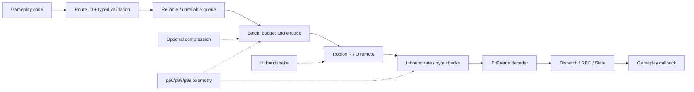
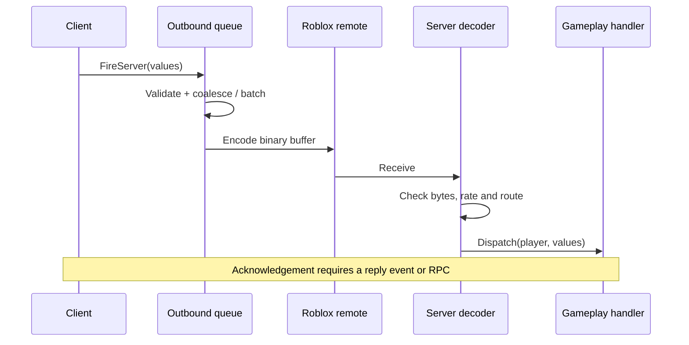
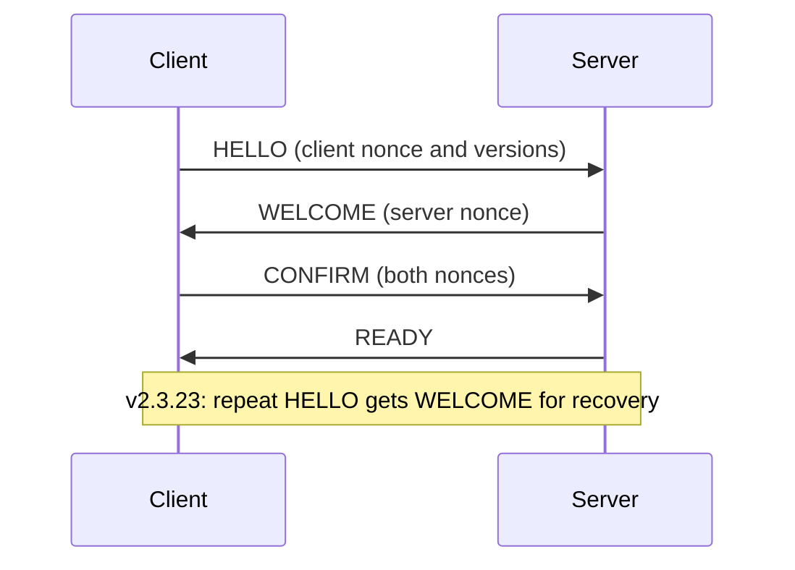

# NetStreamV2

**Reliable/unreliable networking, compact binary schemas, RPC, state, traffic management and performance telemetry for Roblox Luau.**


> **Current `main` release: NetStream v4.0.0.** Bundled child Compression: **v2.4.0**, wire codec **230**. Default packet format: **BitFrame v1**. Source-level checks and Studio test scripts exist. The reported 128-probe RTT and CPU samples are user-supplied and are not a controlled, independently reproduced comparison; v4.0.0 has not yet been measured in Roblox Studio.

## Contents
[Quick start](#quick-start) · [Architecture](#architecture) · [Routes and schemas](#routes-and-schemas) · [Message lifecycle](#message-lifecycle) · [Serialization and compression](#serialization-and-compression) · [Queues and latency](#queues-and-latency) · [Handshake and safety](#handshake-and-safety) · [Performance monitoring](#performance-monitoring) · [Validation](#validation) · [Release notes and documentation](#release-notes-and-documentation)

## Quick start

Put the repository code into **ModuleScripts** in Roblox Studio:

```text
ReplicatedStorage
└── Netstream               -- ModuleScript using Netstream.lua
    └── Compression         -- child ModuleScript using Compression.lua
ServerScriptService
└── NetworkServer           -- Script
StarterPlayer
└── StarterPlayerScripts
    └── NetworkClient       -- LocalScript
```

**Server**: Define a route and an authoritative handler.

```luau
--!strict
local ReplicatedStorage = game:GetService("ReplicatedStorage")
local NetStream = require(ReplicatedStorage:WaitForChild("Netstream"))
local T = NetStream.Types

NetStream.Configure({PerformanceTelemetryEnabled = false})

local BuyUpgrade = NetStream.Event("BuyUpgrade", {
    Id = 1001,
    Schema = {T.U16},
    Priority = "Critical",
    Compression = false,
    MaxPerSecond = 10,
    Burst = 5,
})

local PurchaseResult = NetStream.Event("PurchaseResult", {Id = 1002, Compression = false})

BuyUpgrade:Connect(function(player, upgradeId)
    -- Check price, ownership, currency and cooldown using SERVER data.
    local approved = upgradeId == 7
    PurchaseResult:FireClient(player, approved)
end)
```

**Client**: Define matching routes and transmit a request.

```luau
--!strict
local ReplicatedStorage = game:GetService("ReplicatedStorage")
local NetStream = require(ReplicatedStorage:WaitForChild("Netstream"))
local T = NetStream.Types

local BuyUpgrade = NetStream.Event("BuyUpgrade", {
    Id = 1001,
    Schema = {T.U16},
    Priority = "Critical",
    Compression = false,
})

local PurchaseResult = NetStream.Event("PurchaseResult", {Id = 1002, Compression = false})
PurchaseResult:Connect(function(approved)
    print("Purchase approved:", approved)
end)
BuyUpgrade:FireServer(7)
```

This purchase example is instructional, not a real purchasing system. `FireServer` accepting a message **does not** mean the server approved it. Gameplay authorization must be handled server-side.

## Architecture

NetStream multiplexes logical routes across three Roblox remotes. The default namespace creates `ReplicatedStorage.__NetStream_NetStream`.

| Remote | Roblox type | Purpose |
|---|---|---|
| `R` | `RemoteEvent` | Reliable game messages |
| `U` | `UnreliableRemoteEvent` | Disposable, possibly dropped or reordered updates |
| `H` | `RemoteEvent` | HELLO/WELCOME/CONFIRM/READY control handshake |



**NetStream does not replace Roblox networking or directly lower geographic ping.** Its scheduling, encoding and batching can affect the application-side cost and delay.

[Explore the detailed implementation, packet grammar and component responsibilities](docs/ARCHITECTURE.md).

## Routes and schemas

| API | Description | Typical use |
|---|---|---|
| `NetStream.Event(name, options)` | One-way logical message | Purchase request, UI action |
| `NetStream.Unreliable(name, options)` | One-way disposable update | Cosmetic/movement updates |
| `NetStream.Function(name, options)` | Awaitable request and response | Retrieve server data |
| `NetStream.State(name, options)` | State value and latest update APIs | Health, coins, temporary position |

Example schema route:

```luau
local T = NetStream.Types
local PlayerSnapshot = NetStream.Event("PlayerSnapshot", {
    Id = 2001,
    Schema = {T.U16, T.U8, T.Bool},
    Compression = false,
})
PlayerSnapshot:FireServer(150, 7, true) -- client-side only
```

`U16` occupies 16 bits, `U8` occupies eight, and `Bool` occupies one in the BitFrame field payload (before message header/padding). Server/client must agree on schema and ID. Names can be deterministically hashed; explicit IDs prevent surprises and often encode more compactly.

```luau
-- Server
local GetCoins = NetStream.Function("GetCoins", {Id = 2100})
GetCoins:SetCallback(function(player)
    return 125 -- replace with real authoritative game data
end)

-- Client (same route declaration in its own script)
local GetCoins = NetStream.Function("GetCoins", {Id = 2100})
local coins = GetCoins:InvokeServer()
```

For state updates, `StateRoute:SetLatestClient(player, value)` coalesces replaceable pending values. **Coalescing is not field-by-field delta replication**. The module is also not a DataStore or an entity-interest manager.

## Message lifecycle



The receiver checks incoming envelope rates, optional handshake readiness and byte limits before decoding. It then resolves route IDs, reads schema/dynamic values and dispatches callbacks. RPC calls use request IDs and timeouts. The event dispatch queue is bounded.

## Serialization and compression

**Default BitFrame v1** packs a one-bit message-presence marker, a two-bit message kind, adaptive route/request IDs as needed, and the encoded payload. A zero presence marker terminates the frame; at most seven zero tail bits pad the final byte.

**Schemas:** Known field types avoid dynamic type tags. The current hot paths include **2–32 Bool tuples** (v2.3.21) and **2–32 U8 tuples** (v2.3.24). Both preserve the existing field bit layout.

**Dynamic payloads:** Small scalar values use compact native encodings. Compression is an optional larger-payload path; it is selected only when worthwhile under route, CPU and byte-savings checks.


**Bundled codec capabilities:** Binary scalar, array and map serialization, variable-length integers, string dictionaries, checksum and structural validation. Although NetStream still exposes legacy settings named for Huffman, entropy, delta arrays, run-length arrays and map-key mapping, **those advanced algorithms are not implemented by the bundled Compression v2.4.0 module**. Do not rely on those toggles to enable unavailable compression formats.

v2.3.25 reduces temporary allocation for short, compression-ineligible argument lists. Large lists still use a dictionary to avoid quadratic string comparisons.

## Queues and latency

| Setting | Default | Effect |
|---|---:|---|
| `FlushRate` | 60 Hz | Target module flush cadence |
| `TransportBatchWindowSeconds` | 1/60 s | Normal priority batching |
| `TransportRealtimeBatchWindowSeconds` | 0 | Realtime batching delay |
| `BandwidthGovernorEnabled` | true | Pacing and queue pressure controls |
| `BandwidthLimitBytesPerSecond` | 32 KiB/s | Estimated outgoing per-target budget |
| `BandwidthMaxPacketBytes` | 1,200 B | Target packet size before splitting |
| `UnreliableMaxBytes` | 900 B | Module unreliable payload limit |
| `MaxBatchMessages` | 256 | Selected batch limit |

`Critical` and `Realtime` may use fast flush scheduling. These are application scheduling hints, **not physical priority lanes**. When the `U` remote is unavailable or a payload cannot use it, NetStream may fall back to `R`, changing reliability behavior.

## Handshake and safety



By default, `HandshakeEnabled = true` but `HandshakeRequireReady = false`, so strict readiness gating is opt-in. The handshake checks protocol and codec metadata and handles retries/nonces. It **does not authenticate players, encrypt packets or prevent cheating**.

The server has global/per-player incoming packet, byte, message and RPC limits, plus optional per-route `MaxPerSecond` and `Burst` rate limiting. Your gameplay handler must validate permissions and economic decisions.

## Memory optimization (v2.3.32–v2.3.34)

The BitFrame writer starts at **128 bytes** instead of 1024 bytes and grows on demand; `BitFrameRetainWriterMaxBytes` defaults to **4096 bytes** for idle reuse. Packed schema runs initially allocate for the current fields, not an entire possible 256-message batch. Packed arrays containing more than `MaxPooledPackedValues` (default **64 values**) are released instead of cached.

Unaligned binary schema strings with length **16–63 bytes** now decode through buffers rather than building a per-character Lua table. The **BitFrame wire format and codec ID are unchanged**.

After transient load, `NetStream.TrimPools()` releases **idle** buffers and tables, leaving queued/in-flight traffic intact. Do not call it every frame, since rebuilding pools adds allocation overhead.

```luau
local before = NetStream.GetMemoryDiagnostics()
print(before.BitFrameWriterPooledBytes, before.PackedValuePoolOversizeDrops, before.LuaHeapKB)
local released = NetStream.TrimPools()
print(released.BitFrameWriterPooledBytes, NetStream.GetMemoryDiagnostics().BitFrameWriterPooledBytes)
```

`LuaHeapKB` includes all Luau allocations in the VM, not just NetStream. Memory reductions require identical Roblox Studio workloads and GC-aware baselines. The new `MemoryBinaryRegression` pair covers packed-U8 runs, unaligned string round-trips, and pool trimming.

## Performance monitoring

Telemetry is **opt-in** to limit measurement overhead:

```luau
NetStream.Configure({
    PerformanceTelemetryEnabled = true,
    PerformanceTelemetryCapacity = 512,
    PerformanceTelemetrySampleEvery = 1,
})
NetStream.Start()

local p = NetStream.GetLatencyStats()
print(p.EncodeMs.P95, p.DecodeMs.P99, p.QueueMs.P95)
print(p.RoundTripMs.P95, p.JitterMs.P95)
print(NetStream.GetMemoryDiagnostics().PooledWriterBytes)
print(NetStream.GetCompressionStats().EligibilityShortSkips)
```

Metrics: `EncodeMs`, `DecodeMs`, `QueueMs`, `DispatchMs`, `PacketBytes`, `RoundTripMs` and `JitterMs`. Each sample series reports count, observed count, min/max, mean and nearest-rank p50/p95/p99. **RoundTripMs is not automatically measured**: a client test must call `NetStream.RecordRoundTripSample(milliseconds)` after its own ping/pong exchange.

`gcinfo()` reports the broader Luau heap, not just NetStream-owned allocations. Compression/queue/reader/writer counters are available through `GetStats()`, `GetCompressionStats()`, `GetPerformanceStats()` and `GetBitFrameStats()`.

## Validation

Run the scripts under `tests/` in **Roblox Studio**. Paired `.server.lua` scripts belong in `ServerScriptService` and `.client.lua` in `StarterPlayerScripts`. Use one pair per Play session to avoid configuration conflicts.

Recent regression coverage (v2.3.31):
- `LegacyFixedFiniteGuard`: three malformed legacy composite F64 payloads plus valid recovery; Studio execution is still required.

Originally added in v2.3.25:
- `HandshakeRecovery`: confirm retransmitted matching HELLO receives WELCOME and recovers to READY.
- `U8FastPath`: test 4- and 32-field U8 schemas, boundary values, ordering and fast-path counters.
- `CompressionEligibility`: validate short-list scanning, repeated strings and round-trips.

Existing BitFrame, Boolean, CPU/memory, compression, handshake, batching and p50/p95/p99 probes remain available. Source-level audits do **not** establish passed Studio tests or measured performance. See [Benchmarks and release checklist](docs/BENCHMARKING.md).

## Release notes and documentation

| Release | Main change |
|---|---|
| **4.0.0** | Fast packed Bool/U8/U16 receive preflight; Compression 2.4.0 varint CPU/capacity optimizations, map-key validation, codec-230 compatibility checks and new regression coverage |
| **3.9.0** | Contiguous outbound batch draining; modulo-free dispatch budget checks; direct packed Bool/U8/U16 run writer and 1–3 field vararg packing; 30,000-message paired Studio benchmark |
| **3.8.0** | Drop oversized packed value tables even after runs are split into smaller prefixes; preserve high-water flags through weak keys |
| **3.7.0** | Decode packed one-field Bool/U8/U16/I16/U32/I32/F32/F64 runs without per-value args tables; preserve rate-limit grouping |
| **3.6.0** | Inline BitFrame writer capacity fast path and specialize 1–3 outgoing argument packing |
| **3.5.0** | Bound idle args/message/batch pools, discard oversized transient batches, and avoid unnecessary clearing when pools are full |
| **3.4.0** | Merge scalar dispatch payloads into the existing argument slot; avoid args arrays on rejected dynamic packets |
| **3.3.0** | Bulk skip rate-limited fixed-width schema runs, harden scalar throttling and stage cleanup |
| **3.2.0** | Direct numeric single-field BitFrame scalar schemas, avoiding args tables for U16/I16/U32/I32/F32/F64 |
| **3.1.0** | No per-character Lua tables for short unaligned binary strings; single-byte fast paths |
| **3.0.0** | Precompile exact bit lengths for safe fixed-width schema rejection, with one bounds check |
| **2.9.0** | Validate and skip rejected binary schema payloads without allocating temporary argument arrays |
| **2.8.0** | Pack scalar stage flags/values into existing argument/group slots; preserve nil and FIFO |
| **2.7.0** | Remove duplicate staged route ID arrays; independently cap pooled decoder staging at 8 objects |
| **2.6.0** | Zero-argument-table scalar staging for tiny dynamic and single schema U8/Bool events/states; one-byte varUInt writer fast path |
| **2.5.0** | Bound atomic stage pool retention; add malformed-packet statistics; optimize 1-byte varUInt decode |
| **2.4.0** | Atomic BitFrame decode staging: validate full packet and tail before delivering events, RPC, or state changes |
| **2.3.37** | Preflight 64-bit binary reads/writes once; decode small hybrid strings with a bounded buffer |
| **2.3.36** | Split oversized packed schema runs and bound run sizes to transport byte budgets |
| **2.3.35** | Prevent rate-limited state packets from mutating stored state; validate batch-count configuration |
| **2.3.34** | Replace unaligned string decoding tables with binary buffers and add `TrimPools()` |
| **2.3.33** | Right-size default BitFrame writers to 128 bytes and cap retained writer buffers |
| **2.3.32** | Avoid preallocating maximum packed-run tables and discard oversized pooled arrays |
| **2.3.31** | Reject malformed F64 components in legacy composite fixed-schema decoding |
| **2.3.30** | One bounds check per U8 BitFrame schema run |
| **2.3.29** | Single-validation BitFrame varuint writer |
| **2.3.28** | Handshake remote rebind and encoding safeguards |
| **2.3.27** | Reject malformed BitFrame float32/float64 values |
| **2.3.26** | Adaptive unsigned-integer validation |
| **2.3.25** | Allocation-free short-list compression eligibility screening |

**More detail:** [Architecture](docs/ARCHITECTURE.md) · [Benchmarking](docs/BENCHMARKING.md) · [Changelog](docs/CHANGELOG.md) · [Prioritized next features](docs/NEXT_OPTIONS.md) · [Previous long-form README archive](docs/README_LEGACY_v2.3.22.md).

---
*NetStreamV2 is a source project, not a verified faster-than-everything benchmark. Judge performance using matched Roblox Studio workloads, not feature counts alone.*
### Rebinding the handshake control remote

On a client, call `NetStream.RetryHandshake()` after a control `H` RemoteEvent is replaced. It rebinds a single tracked listener, restarts HELLO/WELCOME/CONFIRM/READY, and reports replacements in `NetStream.GetStats().HandshakeRemoteRebinds`. This is **manual** recovery; the server still needs an active handler on its new `H` remote.

## v2.3.37 verification

New standalone Roblox Studio test pairs: `StateThrottleRegression` (rejected state updates cannot overwrite accepted state), `PackedBudgetRegression` (reliable FIFO and packet-size splitting under a 48-byte budget), and `BinaryPrecisionRegression` (F64 fields and hybrid string round-trips). The source audit also models 5,000 randomized packed splits and preserves existing U8/varuint checks. Live Studio results and CPU/heap/RTT improvements remain unverified until tested under identical loads.


## 2.4.0 → 2.5.0 → 2.6.0 optimization releases

**2.4.0 — Correctness.** BitFrame decoding stages events, RPC calls/results and state updates in pooled structure-of-arrays storage. Only after the final end marker and zero tail padding validate does it dispatch or mutate game state. Malformed packets release their staged arguments rather than delivering partial gameplay effects. The legacy non-BitFrame fallback is unchanged.

**2.5.0 — Heap discipline and bit reading.** Pooled staging arrays are bounded by `MaxPooledBitFrameActions` (default **64**). A malformed large packet will not pin oversized staging arrays. The BitFrame uint decoder has an inlined one-byte fast path with canonical multi-byte overflow and truncation checks. `GetMemoryDiagnostics()` includes `BitFrameStagePoolSize`, `BitFrameStagePoolHits`, `BitFrameAtomicRejectedPackets` and `BitFrameAtomicDiscardedActions`.

**2.6.0 — Scalar specialization.** Tiny one-value dynamic events/states and single U8/Bool schema events/states stage direct values without creating argument tables, then use scalar dispatch. BitFrame uint encoding specializes 0–127 in one byte.

Dedicated paired Studio tests `AtomicPacketRegression` (malformed tail + successful recovery) and `AtomicScalarRegression` (nil, booleans, integers, string, schema U8/Bool and state) were added. **GitHub CI compiles Luau but cannot run Roblox networking or measure RTT, CPU p95, or heap.** Profile against v2.3.37 in the same Roblox Studio session and traffic conditions.

## v2.7.0–v2.9.0: staged heap and CPU optimization

- **2.7.0:** `Internal.BitFrameStagePool` no longer allocates a redundant `routeIds` array for every staging object: a registered route already exposes its `Id`. The new `MaxBitFrameStagePoolSize` defaults to **8**, independently from the 64-entry generic batch pool cap. `GetMemoryDiagnostics()` reports the pool cap.
- **2.8.0:** Scalar events and states are staged using the existing `args` slot and a negative `groups` value. This preserves **nil**, false, numbers and strings without separate scalar flag/value arrays. The atomic staging object now has **five parallel arrays instead of eight**; this is a structural reduction, not a measured whole-VM heap reduction.
- **2.9.0:** When an incoming schema payload fails message-rate validation, `bitFrameDiscardSchemaArgs` still validates framing without creating an argument array. Packed boolean payloads and fixed U8 runs skip bits directly after a bounds check. Mixed fields still use their normal field readers to preserve validation. `BitFrameDiscardedSchemaArgs` counts discarded schema tuples.

New isolated Roblox Studio test pairs: `HeapDiscardRegression` and `StagePoolMemoryRegression`. The source audit now verifies 5,000 randomized signed-group staging models as well as existing layout/varuint tests. Test CPU p95, allocations, full Luau heap and packet p95/p99 in Studio before claiming a performance gain.

## Heap and binary hot-path cycle (v3.0.0–v3.2.0)

- **3.0.0:** Compile `discardBits` for boolean, unsigned/signed fixed integers, U8 and Color3 schema combinations. Rate-limited, fully representable schemas advance by their known bit widths using one bounds check; floats, compressed or variable-width types remain on the validating decode path. `BitFrameDiscardedFixedBits` counts skipped bits.
- **3.1.0:** An unaligned string of one byte becomes a direct `string.char` read. Lengths 2–15 use buffer-based decoding, eliminating the former table-of-characters and per-character string allocation. Empty and byte-aligned string paths are preserved.
- **3.2.0:** Precompile `scalarKind` for single numeric schemas and decode directly into atomic scalar staging. Supported kinds are Bool, U8, U16, I16, U32, I32, F32, and F64; finite-value validation remains active. `BitFrameScalarSchemaReads` is exposed in performance statistics.

Paired Studio scripts: `FixedDiscardRegression` and `ExtendedScalarStringRegression`. These updates preserve **BitFrame v1** and **Compression v2.3.5**. CPU, Luau-heap and RTT improvements remain **unmeasured** until comparable Roblox Studio workloads are run.

## CPU / heap / garbage collection cycle (v3.3.0–v3.5.0)

- **v3.3.0 — CPU work and correctness:** Rejected fixed-width schema runs can be validated with one bit-capacity check and skipped as a group. A route-level rejected scalar no longer attempts to release a number/boolean through an argument-table pool. BitFrame staged actions remain referenced during commit so errors can release remaining arguments. New diagnostic: `BitFrameBulkDiscardedRuns`.
- **v3.4.0 — Transient allocations:** Scalar dispatch reuses `dispatchArgs` for the value, with a separate Boolean flag to preserve `nil`. This removes the `dispatchScalarValues` table. Disallowed dynamic multi-arg and RPC-return packets still validate/consume fields but avoid acquiring an args table. Counter: `BitFrameRejectedDynamicArgsAvoided`.
- **v3.5.0 — Retained Luau heap:** Default `MaxArgsPoolSize=512`, `MaxMessagePoolSize=512` (also capped by `MaxPoolSize`), and `MaxPooledBatchItems=512`. Oversized batch tables are transient, and full batch, packed-value and BitFrame stage pools skip unnecessary `table.clear` operations on dropped objects. New counters: `ArgsPoolLimitDrops`, `MessagePoolLimitDrops`, `BatchPoolOversizeDrops`.

**Tuning:** Reducing pool limits lowers retained idle memory after spikes but may raise allocations in sustained burst workloads; increase caps when real Studio profiles justify it. Run `NetStream.GetMemoryDiagnostics()` after spikes and `NetStream.TrimPools()` only at safe transition points, not every frame.

**Verification:** Three new Studio regression pairs: `ScalarThrottleHeapRegression`, `DynamicDiscardHeapRegression`, and `BoundedPoolRegression`. GitHub Actions audits and Luau parse/compile checks are source-level only. No measured throughput/heap/GC improvement is claimed. The wire format remains BitFrame v1 and the bundled codec stays Compression v2.3.5.

## CPU / Luau heap / GC pressure cycle (v3.6.0–v3.8.0)

- **v3.6.0 — CPU overhead:** The common `BitFrameWriter:bits` operation avoids calling `ensureBits` when both buffer capacity and configured maximum allow an immediate bit write. Incoming limits remain enforced. Outgoing `makeArgs` packs 1, 2 or 3 values directly (including nil); larger arities retain the existing general loop.
- **v3.7.0 — Fewer Luau allocations:** Packed BitFrame event runs with a one-field Bool, U8, U16, I16, U32, I32, F32 or F64 schema directly stage scalar values, without acquiring one arguments table per item. Group tags preserve one route-token allowance charge per run and FIFO delivery. `BitFramePackedScalarRunItems` tracks logical items using this path.
- **v3.8.0 — Lower retained heap and GC pressure:** A weak-key high-water set tracks packed value arrays once they exceed `MaxPooledPackedValues`, including while appending or splitting runs. Such arrays cannot be returned to the small-value pool even when the final prefix contains very few values. `PackedValueHighWaterDrops` records these discards. Idle pool configuration and `TrimPools()` remain unchanged.

Paired Studio regression scripts: `PackedScalarRunRegression` and `PackedHighWaterRegression`. These patches retain **BitFrame v1**, existing public routes and **Compression v2.3.5**. GitHub Actions syntax/source checks do not establish faster CPU p95, lower `gcinfo()`, smaller GC pauses, or lower network RTT; measure identical before-and-after Studio loads.


## v3.9.0 burst send / receive evaluation

Outbound collection now drains contiguous FIFO entries with one logical-count adjustment per batch, while keeping packed-run indivisibility and latest-value precedence unchanged. Dispatch CPU budget checks use a 32-event checkpoint rather than a modulo operation on every callback. Packed one-field Bool/U8/U16 runs are preflighted and written straight to the buffer, without calling the general schema writer for each item. Tiny fixed-arity packed arguments (1–3 fields) avoid repeated indexed `select` calls.

The wire format remains **BitFrame v1**, Compression **v2.3.5** and all existing public route APIs are retained. `NetStream.GetStats().BitFramePackedScalarRunWrites` counts eligible logical messages encoded through the direct packed-run writer, not all messages, and not a measured speedup.

**Run in Studio:** The paired `tests/BurstSaturationBenchmark.server.lua` / `.client.lua` scripts exercise 10,000 U16, 10,000 Bool and 10,000 U8×8 messages. Run one client at a time initially; check server and client for PASS and compare matched runs against v3.8.0. Use [benchmark instructions](docs/BENCHMARKING.md) to compare p50/p95/p99 CPU, throughput and Luau heap. Source audit and syntax compilation alone cannot prove a throughput or garbage-collection improvement.


## v4.0.0 and Compression v2.4.0 release

- **NetStream receive optimization:** For packed Bool/U8/U16 schema-event runs, preflight all bits once and decode directly with `buffer.readbits`, avoiding repeated per-value reader method and bounds-check overhead. The values are still staged atomically and dispatched in order after final-frame validation. `GetStats().BitFramePackedScalarFastReads` counts qualifying items (not a speedup measurement).
- **Compression CPU and heap:** One-byte varuints use a direct write/read path; multi-byte varuint writers reserve the exact encoded length rather than eight bytes. Pooled compression writers now remove an eligible item by swapping with the pool tail rather than shifting pool entries.
- **Compression correctness:** Reject unsupported reference-identity map keys such as tables during both encoding and decoding, rather than silently producing semantically different maps. Retain rejection of noncanonical/truncated/oversized varuints.
- **Wire compatibility:** Compression reports v2.4.0 but retains packet codec **230**, magic `0x4E433233`, header size and tags. NetStream v4.0.0 can load both 2.3.x and 2.4.x compression cores when codec 230 matches. This is an API/implementation release, **not a new wire version**; both peers still need matching route IDs, schema and BitFrame settings.
- **Verification:** `tests/CompressionV24Regression.server.lua` covers numeric round-trips, pooled packet retention, malformed varints and invalid map keys. Run paired `PackedScalarRunRegression` and `BurstSaturationBenchmark` in Studio and compare matched v3.9.0/v4.0.0 conditions. Static source audits and Luau compilation are not proof of faster networking, lower RTT or lower GC pauses.
