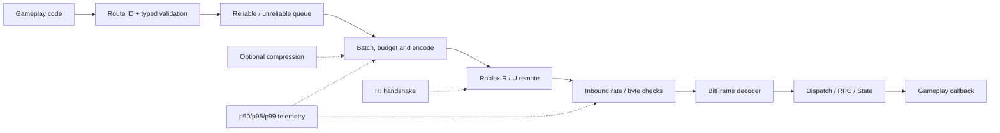
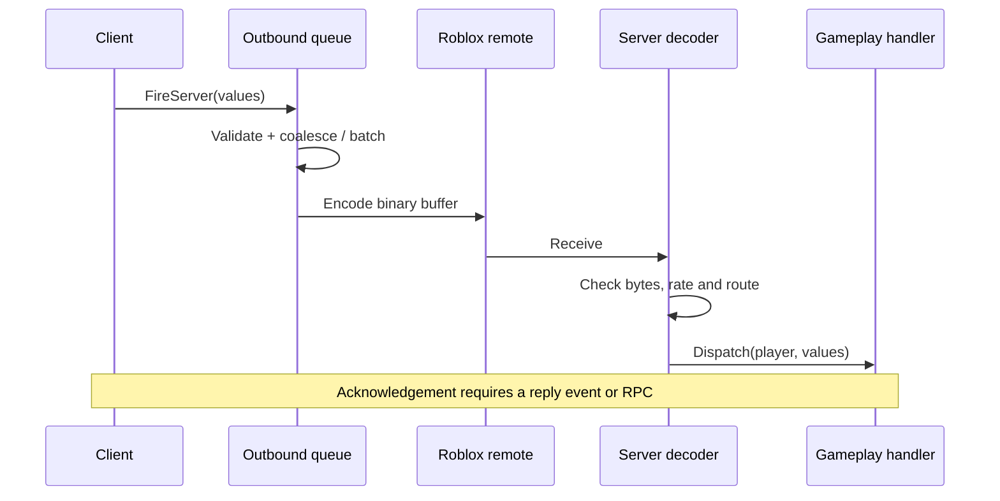
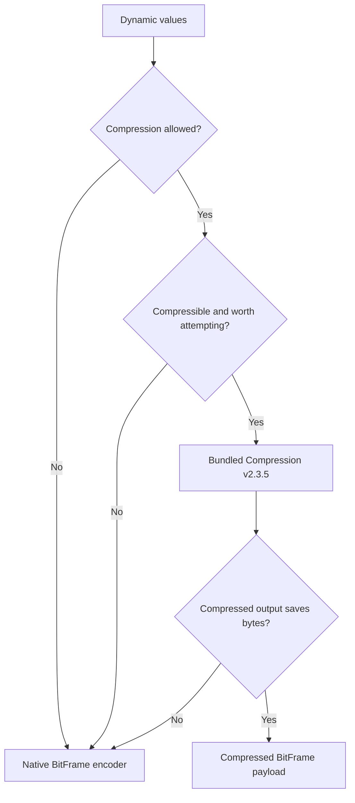
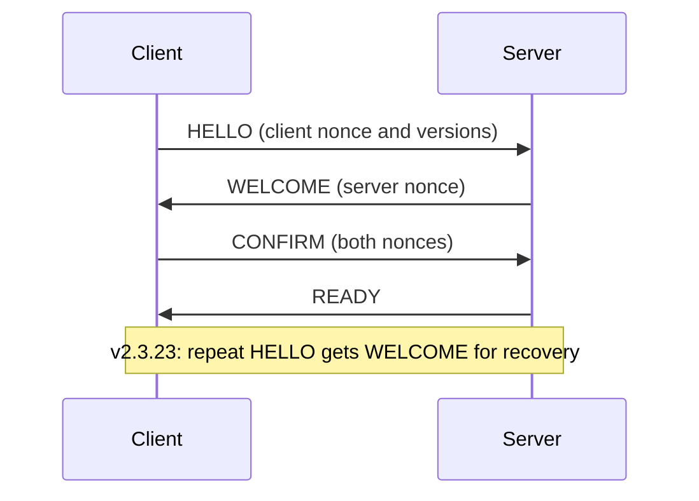

# NetStreamV2

**Reliable/unreliable networking, compact binary schemas, RPC, state, traffic management and performance telemetry for Roblox Luau.**


> **Current `main` release: NetStream v2.3.31.** Bundled child Compression: **v2.3.5**, wire codec **230**. Default packet format: **BitFrame v1**. Source-level checks and Studio test scripts exist. The reported 128-probe RTT and CPU samples are user-supplied and are not a controlled, independently reproduced comparison; v2.3.31 has not yet been measured in Roblox Studio.

## Contents
[Quick start](#quick-start) · [Architecture](#architecture) · [Routes and schemas](#routes-and-schemas) · [Message lifecycle](#message-lifecycle) · [Serialization and compression](#serialization-and-compression) · [Queues and latency](#queues-and-latency) · [Handshake and safety](#handshake-and-safety) · [Performance monitoring](#performance-monitoring) · [Validation](#validation) · [Release notes and documentation](#release-notes-and-documentation)

## Quick start

Put the repository code into **ModuleScripts** in Roblox Studio:

```text
ReplicatedStorage
└── Netstream               -- ModuleScript using Netstream.lua
    └── Compression         -- child ModuleScript using Compression.lua
ServerScriptService
└── NetworkServer           -- Script
StarterPlayer
└── StarterPlayerScripts
    └── NetworkClient       -- LocalScript
```

**Server**: Define a route and an authoritative handler.

```luau
--!strict
local ReplicatedStorage = game:GetService("ReplicatedStorage")
local NetStream = require(ReplicatedStorage:WaitForChild("Netstream"))
local T = NetStream.Types

NetStream.Configure({PerformanceTelemetryEnabled = false})

local BuyUpgrade = NetStream.Event("BuyUpgrade", {
    Id = 1001,
    Schema = {T.U16},
    Priority = "Critical",
    Compression = false,
    MaxPerSecond = 10,
    Burst = 5,
})

local PurchaseResult = NetStream.Event("PurchaseResult", {Id = 1002, Compression = false})

BuyUpgrade:Connect(function(player, upgradeId)
    -- Check price, ownership, currency and cooldown using SERVER data.
    local approved = upgradeId == 7
    PurchaseResult:FireClient(player, approved)
end)
```

**Client**: Define matching routes and transmit a request.

```luau
--!strict
local ReplicatedStorage = game:GetService("ReplicatedStorage")
local NetStream = require(ReplicatedStorage:WaitForChild("Netstream"))
local T = NetStream.Types

local BuyUpgrade = NetStream.Event("BuyUpgrade", {
    Id = 1001,
    Schema = {T.U16},
    Priority = "Critical",
    Compression = false,
})

local PurchaseResult = NetStream.Event("PurchaseResult", {Id = 1002, Compression = false})
PurchaseResult:Connect(function(approved)
    print("Purchase approved:", approved)
end)
BuyUpgrade:FireServer(7)
```

This purchase example is instructional, not a real purchasing system. `FireServer` accepting a message **does not** mean the server approved it. Gameplay authorization must be handled server-side.

## Architecture

NetStream multiplexes logical routes across three Roblox remotes. The default namespace creates `ReplicatedStorage.__NetStream_NetStream`.

| Remote | Roblox type | Purpose |
|---|---|---|
| `R` | `RemoteEvent` | Reliable game messages |
| `U` | `UnreliableRemoteEvent` | Disposable, possibly dropped or reordered updates |
| `H` | `RemoteEvent` | HELLO/WELCOME/CONFIRM/READY control handshake |



**NetStream does not replace Roblox networking or directly lower geographic ping.** Its scheduling, encoding and batching can affect the application-side cost and delay.

[Explore the detailed implementation, packet grammar and component responsibilities](docs/ARCHITECTURE.md).

## Routes and schemas

| API | Description | Typical use |
|---|---|---|
| `NetStream.Event(name, options)` | One-way logical message | Purchase request, UI action |
| `NetStream.Unreliable(name, options)` | One-way disposable update | Cosmetic/movement updates |
| `NetStream.Function(name, options)` | Awaitable request and response | Retrieve server data |
| `NetStream.State(name, options)` | State value and latest update APIs | Health, coins, temporary position |

Example schema route:

```luau
local T = NetStream.Types
local PlayerSnapshot = NetStream.Event("PlayerSnapshot", {
    Id = 2001,
    Schema = {T.U16, T.U8, T.Bool},
    Compression = false,
})
PlayerSnapshot:FireServer(150, 7, true) -- client-side only
```

`U16` occupies 16 bits, `U8` occupies eight, and `Bool` occupies one in the BitFrame field payload (before message header/padding). Server/client must agree on schema and ID. Names can be deterministically hashed; explicit IDs prevent surprises and often encode more compactly.

```luau
-- Server
local GetCoins = NetStream.Function("GetCoins", {Id = 2100})
GetCoins:SetCallback(function(player)
    return 125 -- replace with real authoritative game data
end)

-- Client (same route declaration in its own script)
local GetCoins = NetStream.Function("GetCoins", {Id = 2100})
local coins = GetCoins:InvokeServer()
```

For state updates, `StateRoute:SetLatestClient(player, value)` coalesces replaceable pending values. **Coalescing is not field-by-field delta replication**. The module is also not a DataStore or an entity-interest manager.

## Message lifecycle



The receiver checks incoming envelope rates, optional handshake readiness and byte limits before decoding. It then resolves route IDs, reads schema/dynamic values and dispatches callbacks. RPC calls use request IDs and timeouts. The event dispatch queue is bounded.

## Serialization and compression

**Default BitFrame v1** packs a one-bit message-presence marker, a two-bit message kind, adaptive route/request IDs as needed, and the encoded payload. A zero presence marker terminates the frame; at most seven zero tail bits pad the final byte.

**Schemas:** Known field types avoid dynamic type tags. The current hot paths include **2–32 Bool tuples** (v2.3.21) and **2–32 U8 tuples** (v2.3.24). Both preserve the existing field bit layout.

**Dynamic payloads:** Small scalar values use compact native encodings. Compression is an optional larger-payload path; it is selected only when worthwhile under route, CPU and byte-savings checks.



**Bundled codec capabilities:** Binary scalar, array and map serialization, variable-length integers, string dictionaries, checksum and structural validation. Although NetStream still exposes legacy settings named for Huffman, entropy, delta arrays, run-length arrays and map-key mapping, **those advanced algorithms are not implemented by the bundled Compression v2.3.5 module**. Do not rely on those toggles to enable unavailable compression formats.

v2.3.25 reduces temporary allocation for short, compression-ineligible argument lists. Large lists still use a dictionary to avoid quadratic string comparisons.

## Queues and latency

| Setting | Default | Effect |
|---|---:|---|
| `FlushRate` | 60 Hz | Target module flush cadence |
| `TransportBatchWindowSeconds` | 1/60 s | Normal priority batching |
| `TransportRealtimeBatchWindowSeconds` | 0 | Realtime batching delay |
| `BandwidthGovernorEnabled` | true | Pacing and queue pressure controls |
| `BandwidthLimitBytesPerSecond` | 32 KiB/s | Estimated outgoing per-target budget |
| `BandwidthMaxPacketBytes` | 1,200 B | Target packet size before splitting |
| `UnreliableMaxBytes` | 900 B | Module unreliable payload limit |
| `MaxBatchMessages` | 256 | Selected batch limit |

`Critical` and `Realtime` may use fast flush scheduling. These are application scheduling hints, **not physical priority lanes**. When the `U` remote is unavailable or a payload cannot use it, NetStream may fall back to `R`, changing reliability behavior.

## Handshake and safety



By default, `HandshakeEnabled = true` but `HandshakeRequireReady = false`, so strict readiness gating is opt-in. The handshake checks protocol and codec metadata and handles retries/nonces. It **does not authenticate players, encrypt packets or prevent cheating**.

The server has global/per-player incoming packet, byte, message and RPC limits, plus optional per-route `MaxPerSecond` and `Burst` rate limiting. Your gameplay handler must validate permissions and economic decisions.

## Performance monitoring

Telemetry is **opt-in** to limit measurement overhead:

```luau
NetStream.Configure({
    PerformanceTelemetryEnabled = true,
    PerformanceTelemetryCapacity = 512,
    PerformanceTelemetrySampleEvery = 1,
})
NetStream.Start()

local p = NetStream.GetLatencyStats()
print(p.EncodeMs.P95, p.DecodeMs.P99, p.QueueMs.P95)
print(p.RoundTripMs.P95, p.JitterMs.P95)
print(NetStream.GetMemoryDiagnostics().PooledWriterBytes)
print(NetStream.GetCompressionStats().EligibilityShortSkips)
```

Metrics: `EncodeMs`, `DecodeMs`, `QueueMs`, `DispatchMs`, `PacketBytes`, `RoundTripMs` and `JitterMs`. Each sample series reports count, observed count, min/max, mean and nearest-rank p50/p95/p99. **RoundTripMs is not automatically measured**: a client test must call `NetStream.RecordRoundTripSample(milliseconds)` after its own ping/pong exchange.

`gcinfo()` reports the broader Luau heap, not just NetStream-owned allocations. Compression/queue/reader/writer counters are available through `GetStats()`, `GetCompressionStats()`, `GetPerformanceStats()` and `GetBitFrameStats()`.

## Validation

Run the scripts under `tests/` in **Roblox Studio**. Paired `.server.lua` scripts belong in `ServerScriptService` and `.client.lua` in `StarterPlayerScripts`. Use one pair per Play session to avoid configuration conflicts.

Recent regression coverage (v2.3.31):
- `LegacyFixedFiniteGuard`: three malformed legacy composite F64 payloads plus valid recovery; Studio execution is still required.

Originally added in v2.3.25:
- `HandshakeRecovery`: confirm retransmitted matching HELLO receives WELCOME and recovers to READY.
- `U8FastPath`: test 4- and 32-field U8 schemas, boundary values, ordering and fast-path counters.
- `CompressionEligibility`: validate short-list scanning, repeated strings and round-trips.

Existing BitFrame, Boolean, CPU/memory, compression, handshake, batching and p50/p95/p99 probes remain available. Source-level audits do **not** establish passed Studio tests or measured performance. See [Benchmarks and release checklist](docs/BENCHMARKING.md).

## Release notes and documentation

| Release | Main change |
|---|---|
| **2.3.31** | Validate finite F64 components in legacy fixed composite schema reads |
| **2.3.30** | Preflight U8 BitFrame schema bounds once and directly read/write packed bytes |
| **2.3.29** | Remove redundant BitFrame varuint validation on the hot path |


| Release | Main change |
|---|---|
| **2.3.23** | Recover matching HELLO retries after a server reaches READY |
| **2.3.24** | Specialized 2–32 U8 encode/decode without wire changes |
| **2.3.25** | Allocation-free short-list compression eligibility screening |

**More detail:** [Architecture](docs/ARCHITECTURE.md) · [Benchmarking](docs/BENCHMARKING.md) · [Changelog](docs/CHANGELOG.md) · [Prioritized next features](docs/NEXT_OPTIONS.md) · [Previous long-form README archive](docs/README_LEGACY_v2.3.22.md).

---
*NetStreamV2 is a source project, not a verified faster-than-everything benchmark. Judge performance using matched Roblox Studio workloads, not feature counts alone.*
### Rebinding the handshake control remote

On a client, call `NetStream.RetryHandshake()` after a control `H` RemoteEvent is replaced. It rebinds a single tracked listener, restarts HELLO/WELCOME/CONFIRM/READY, and reports replacements in `NetStream.GetStats().HandshakeRemoteRebinds`. This is **manual** recovery; the server still needs an active handler on its new `H` remote.
