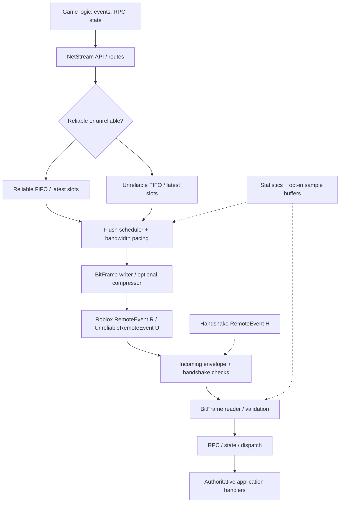
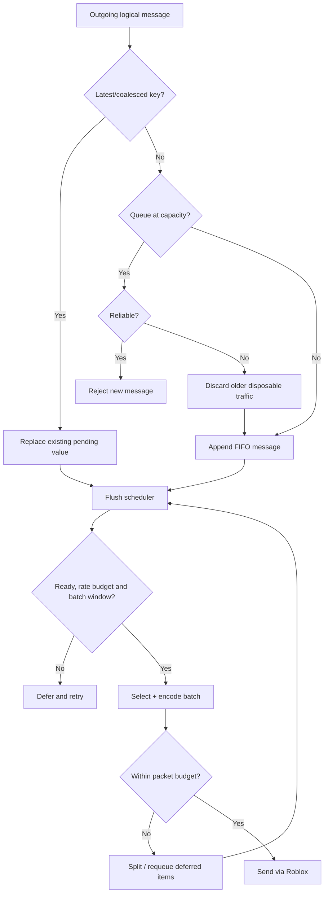
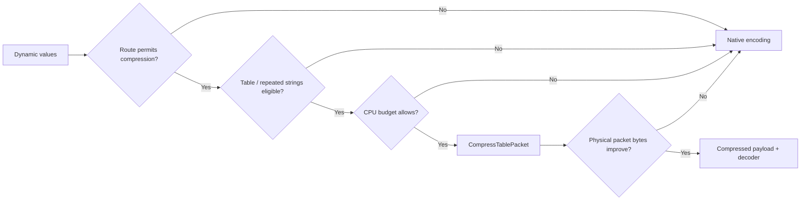
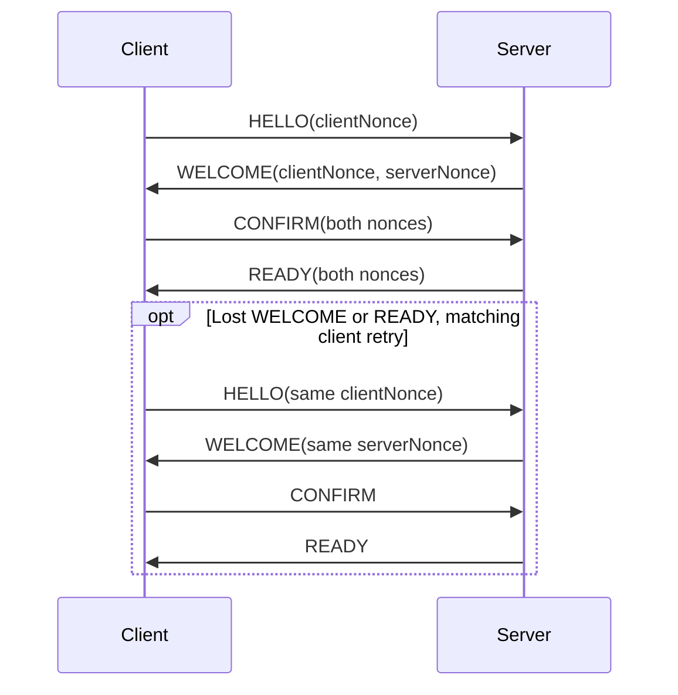

# NetStreamV2 Architecture

**Applies to NetStream v2.3.25, BitFrame v1, Compression v2.3.5 (codec 230).**

This guide describes the actual architecture in [Netstream.lua](../Netstream.lua) and [Compression.lua](../Compression.lua). All performance outcomes require measurement in Roblox Studio; the diagrams below are explanatory, not benchmark results.

## 1. Responsibility boundaries

NetStream provides a networking API, serialization, traffic scheduling, session-capability handshake, validation and telemetry. Roblox supplies the actual network transport. Your server gameplay scripts remain responsible for ownership, inventory, spending, state persistence, permissions and anti-exploit logic.



## 2. Startup and remote setup

`NetStream.Configure(options)` clones and validates settings, then writes configuration only if valid. Call it **before** registering a route; `Event`, `State` and `Function` start NetStream implicitly. `Start()` is also available explicitly.

On startup the server creates `__NetStream_` + namespace (default `NetStream`) inside `ReplicatedStorage`, and manages the `R`, `U` and `H` remotes. Clients wait for the folder and reliable remote. The module registers remote receive handlers and a Heartbeat listener used for dispatch, outgoing flush, request timeout sweeps, traffic snapshots and handshake retries.

For every remote route, server and client must use compatible IDs, field schemas, bitframe settings and codec. Route IDs may be explicit or generated by a deterministic name hash. IDs are distinguished by route family (Event, State, Function) in the route tables.

## 3. Sending and outbound state

The three logical message classes are:
- **Event:** One-way application message. There is no automatic receipt confirmation.
- **Function / RPC:** A call has a request ID. The initiating coroutine yields until a response arrives, a timeout occurs, or the pending call fails.
- **State:** Decoded values are cached in a per-peer state table and may notify listeners. State can be sent as a normal message or as a replaceable latest value.

The queue is logically divided by **target** and **reliability**. Each side has FIFO queues and maps of latest-key messages. A new latest value overwrites the old queued value for its route. `Normal`, `Realtime`, and `Critical` determine the initial flush window and fast-flush eligibility; they do not create additional physical remotes.



For estimated congestion control, the bandwidth governor tracks bytes and packet pacing per target (and a broadcast requirement where applicable). It estimates overhead, so this is not a physical bandwidth quota or Roblox engine transport guarantee. If unreliable transport cannot be used, the module may fall back to reliable delivery.

**v2.3.22**: deferred FIFO restoration avoids a temporary `table.create` array, keeping survivor order and newest-key replacement. **v2.3.25**: common short compression-ineligible argument lists avoid a temporary string-dictionary allocation.

## 4. BitFrame v1 packet layout

The default `BitFrameEnabled = true` codec operates on Luau `buffer.readbits` and `buffer.writebits`.

```text
[Present=1] [Kind:2] [RouteID:adaptive?] [RequestID:adaptive?] [Payload]
[Present=1] [Kind:2] [RouteID...] [Payload...]
...
[Present=0] [0..7 physical zero-padding bits]
```

Event, State and Function packets use route IDs; function calls and returns additionally use request IDs. A schema payload has a predetermined field sequence, while a dynamic payload can contain a native scalar, a typed native sequence, or a bounded compressed buffer.

Schemas compile once at registration. The module checks the schema signature against any existing route registration. Its Bool-only (v2.3.21) and U8-only (v2.3.24) fast paths for 2–32 fields skip the generic field-type switch while preserving field bits. Non-matching schemas use the general field writer/reader. **These specializations do not change the BitFrame v1 version or reduce the information content of a U8 field.**

The decoder rejects packets with unknown routes, unsupported kinds, malformed adaptive integers, excessive logical counts, overflow or more than seven unused zero tail bits. BitFrame writers and readers return to pools; the v2.3.20 writer error path also returns a writer to its pool after a failed encode.

**Caveat:** Some events are decoded and dispatched/queued before the terminal BitFrame padding check occurs. Therefore a malformed trailing frame can still cause earlier valid messages to be processed. Applications must not assume whole-packet transactional/atomic delivery.

## 5. Compression and the actual adapter

The bundled compression module is a distinct API (`CompressTablePacket` / `DecompressTable`). The Netstream main module adapts it into its local `Compression.Compress` / `Compression.Decode` helpers.

The adapter currently translates dictionary settings, maximum depth/nodes, deterministic map and memory/preallocation options. The binary codec supports scalar, string dictionary, arrays/maps and checksum-verified frames. Options in NetStream config named for entropy/Huffman, delta or RLE **are not implemented by this bundled v2.3.5 compressor**.

Compressed data should only be chosen after checking route permission, data eligibility, rough byte savings, hybrid thresholds and the route's measured/estimated compression CPU budget. A per-route EMA and periodic probes prevent repeated costly automatic compression in expensive workloads. Explicit compression-on routes can bypass automatic CPU-gating.



## 6. Handshake protocol

A distinct reliable `H` RemoteEvent exchanges protocol ID, compression codec ID, BitFrame flag and two session nonces.



The server remembers a bounded set of previous client nonces to reject stale replays and rate-limits immediate repeated HELLOs. **v2.3.23** changes the matching HELLO response from READY to WELCOME when already server-ready, letting a client still in HELLO state recover. This is a compatibility/session feature, not encryption or identity authentication.

By default `HandshakeEnabled = true` but `HandshakeRequireReady = false`. With strict readiness enabled, outbound queues wait for readiness. A broadcast can be held if an included player is not ready. Plan reconnect/failure behavior explicitly.

## 7. Incoming checks and dispatch

Incoming traffic passes these checks in broad order:
1. Envelope rate limits on byte count and batch frequency (per-player and global).
2. Optional session readiness gate.
3. Packet type and byte limit.
4. Decoder parsing: bitstream layout, message kind, route ID, schema fields and dynamic values.
5. Message/call/route token limits.
6. Event dispatch queue or RPC handler, and state cache updates.

The dispatch queue has bounded backlog and processes messages in Heartbeat work slices. Callback errors are caught and logged. RPC handlers are spawned and their responses routed back to the original pending request. This enables normal Roblox gameplay handlers but **does not** turn untrusted client values into trusted facts.

## 8. Memory and telemetry

The module pools BitFrame writers/readers, legacy readers/writers, message objects, argument arrays and batch buffers. Pooled buffer capacity is retained by design, so a high pool hit count is not equivalent to a net memory saving under every workload.

When `PerformanceTelemetryEnabled = true`, bounded sample series track `EncodeMs`, `DecodeMs`, `DispatchMs`, `QueueMs`, `PacketBytes`, `RoundTripMs` and `JitterMs` with nearest-rank p50/p95/p99, min/max and mean. RTT samples are caller-supplied from explicit ping/pong probes; they are not built-in ongoing ICMP ping.

`GetMemoryDiagnostics().LuaHeapKB` uses `gcinfo()` for the broader Luau heap; `PooledWriterBytes` counts pooled buffer *capacity*, not total NetStream memory.

## 9. Operating guidance

- Use explicit schema routes for hot, fixed-shape game traffic.
- Use unreliable latest/coalesced state only when dropping superseded packets is acceptable.
- Use reliable routes for purchases, inventory, state-changing requests and transactional messages.
- Validate permissions, ownership, quantities and economics in authoritative server handlers.
- Keep one shared route catalogue with IDs/schemas matched between server and client.
- Run tests under `tests/` in Studio and collect actual p50/p95/p99, packet sizes, CPU and memory before optimizing for a benchmark score.

For a repeatable test procedure, see [BENCHMARKING.md](BENCHMARKING.md). For future code-generation and state-delta plans, see [NEXT_OPTIONS.md](NEXT_OPTIONS.md).