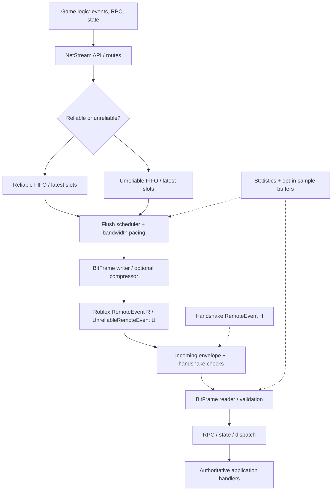
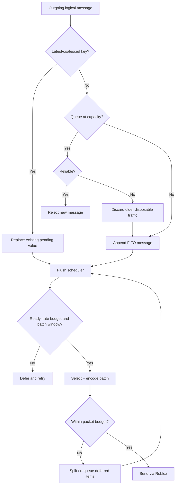
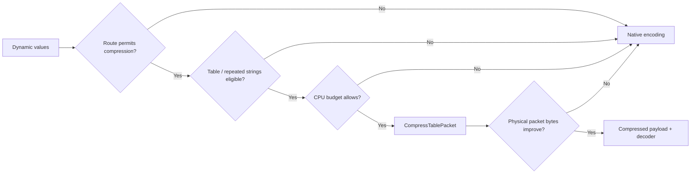
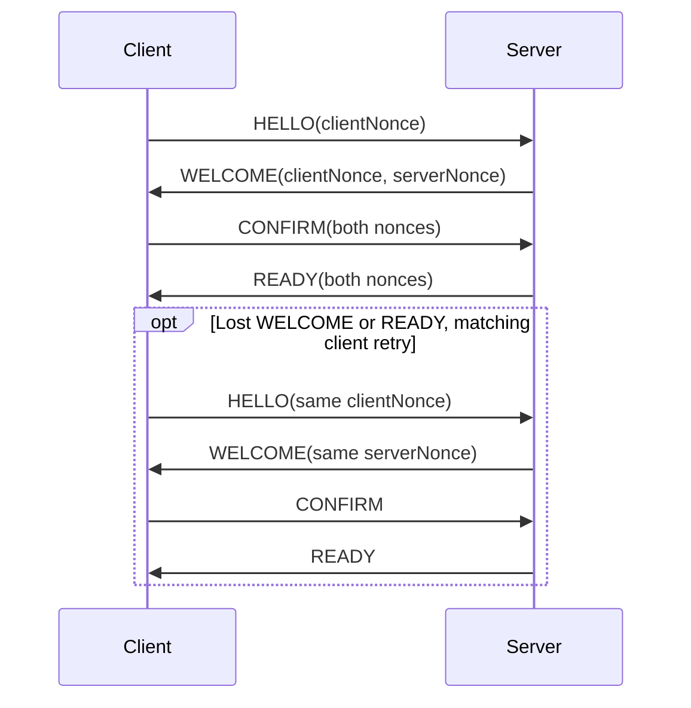

# NetStreamV2 Architecture

> **Applies to:** The current v4.3.1-compatible `main` branch, BitFrame v1, and bundled Compression v2.4.2 (codec 230). Older version-specific sections below document the evolution of the same codebase.

This guide describes the actual architecture in [Netstream.lua](../Netstream.lua) and [Compression.lua](../Compression.lua). All performance outcomes require measurement in Roblox Studio; the diagrams below are explanatory, not benchmark results.

[← Documentation index](README.md) · [Server security](SECURITY.md) · [Replica API](AUTHORITATIVE_REPLICATION.md)

## System boundaries

```text
Client game code
  → NetStream route / serializer
  → Reliable or unreliable Roblox remote
  → Server input limits and route policy
  → Application's authoritative gameplay handler
  → Server-owned state / optional replica controller
  → Revisioned full or delta updates with ACK and resync
  → Client read-only state mirror
```

| Boundary | Owner | Important rule |
| --- | --- | --- |
| Remote transport | Roblox engine and NetStream scheduler | Unreliable updates can be dropped; queues and budgets are bounded |
| Packet decoding | NetStream serialization layer | Successfully decoded input is still untrusted |
| Command permission | Server route policy plus gameplay code | Validate both admission and mutable state at commit time |
| Replication baseline | Experimental `AuthoritativeState` controller | Only server state forms the next snapshot; ACKs affect delivery state, not currency |
| Durable player data | Game's persistence layer | Replication does not provide DataStore consistency or exactly-once transactions |

The owner-replica controller is an optional child ModuleScript. It complements, rather than replaces, the existing `Event`, `Function`, `State`, and `CreateDeltaCodec` APIs.

## Current architecture at a glance

- **Server authority:** Inbound Event/Function callbacks support per-route policies and optional default-deny enforcement. Server-issued tickets and idempotency helpers are server-local controls; they do not establish client integrity or durable exactly-once execution.
- **State trust:** Client-origin State routes can be rejected before updating server peer-state caches. Snapshot getters return detached copies but remain untrusted data.
- **Packer:** BitFrame v1 is still the default wire format. Standalone Codec adds a byte-compatible direct path for tiny primitive tuples and uses bounded pools for complex payloads.
- **Limits:** The latest code enforces codec argument and writer-byte limits, including optimized fast paths.
- **Verification:** Executable Luau and deterministic stress suites run in CI; Roblox Studio network, heap, and end-to-end throughput measurements require separate runs.

See [Security](SECURITY.md), [Action tickets](ACTION_GATE_SECURITY.md), [Packer optimization](PACKER_MEMORY_OPTIMIZATION.md), and [Runtime validation](RUNTIME_VALIDATION.md).

## 1. Component responsibilities

NetStream provides a networking API, serialization, traffic scheduling, session-capability handshake, validation, and telemetry. Roblox supplies the actual network transport. Your server gameplay scripts remain responsible for ownership, inventory, spending, state persistence, permissions and anti-exploit logic.



### v4.3.0 dispatch and flush fairness

A weak-key map counts pending server event callbacks by Player. The admission check applies both global and per-player limits before queueing a table or scalar callback. Dequeue returns the per-player quota before invoking callbacks. If the sender has disconnected, its queued callback is discarded without firing and any owned argument array is released. This controls callback backlog, **not** transport-level packet receipt or RPC scheduling.

Periodic outbound flushes share a single time budget. When both broadcast and individual target queues are active, broadcasts receive a configured fraction, leaving processing time for existing round-robin per-target queues. No new wire headers or physical priority lanes are introduced.

### v4.2.1–v4.2.3 packet efficiency and state boundaries

Mixed fixed-width packed runs preflight the entire run once and read/write each field directly; BitFrame v1 field order is identical.

`CreateDeltaCodec` is an application-managed full/delta frame constructor and validator; it is not integrated with StateRoute queues, acknowledgments or resync. The application must retain per-target baselines, send over a reliable ordered Event and resend a full snapshot after mismatch or reconnect. Frame revisions and bitmask validation prevent malformed or out-of-order deltas from mutating state.

`CreateInterestGroup` is a server-owned weak-key Player membership set. It sends only to connected subscribers over existing validated NetStream Event or State routes. Recipient counts reflect successful enqueue, not confirmed delivery, and membership requires application-maintained AOI logic.

### v4.2.0 mixed fixed-width schema specialization

At route registration, a 2–32-field Bool/U8/U16/I16/U32/I32 schema caches its per-field bit widths. BitFrame v1 keeps the same packing order but does one whole-payload preflight and direct bit-buffer reads/writes, with two's-complement reconstruction for I16/I32. All-Bool and all-U8 specializations take precedence. The default packed-run eligibility limit grows from 8 to 16 fields, with potentially greater temporary allocation. This is not a new wire codec.

## 2. Startup and remote setup

`NetStream.Configure(options)` clones and validates settings, then writes configuration only if valid. Call it **before** registering a route; `Event`, `State` and `Function` start NetStream implicitly. `Start()` is also available explicitly.

On startup the server creates `__NetStream_` + namespace (default `NetStream`) inside `ReplicatedStorage`, and manages the `R`, `U` and `H` remotes. Clients wait for the folder and reliable remote. The module registers remote receive handlers and a Heartbeat listener used for dispatch, outgoing flush, request timeout sweeps, traffic snapshots and handshake retries.

For every remote route, server and client must use compatible IDs, field schemas, bitframe settings and codec. Route IDs may be explicit or generated by a deterministic name hash. IDs are distinguished by route family (Event, State, Function) in the route tables.

## 3. Sending and outbound state

The three logical message classes are:
- **Event:** One-way application message. There is no automatic receipt confirmation.
- **Function / RPC:** A call has a request ID. The initiating coroutine yields until a response arrives, a timeout occurs, or the pending call fails.
- **State:** Decoded values are cached in a per-peer state table and may notify listeners. State can be sent as a normal message or as a replaceable latest value.

The queue is logically divided by **target** and **reliability**. Each side has FIFO queues and maps of latest-key messages. A new latest value overwrites the old queued value for its route. `Normal`, `Realtime`, and `Critical` determine the initial flush window and fast-flush eligibility; they do not create additional physical remotes.



For estimated congestion control, the bandwidth governor tracks bytes and packet pacing per target (and a broadcast requirement where applicable). It estimates overhead, so this is not a physical bandwidth quota or Roblox engine transport guarantee. If unreliable transport cannot be used, the module may fall back to reliable delivery.

**v2.3.22**: deferred FIFO restoration avoids a temporary `table.create` array, keeping survivor order and newest-key replacement. **v2.3.25**: common short compression-ineligible argument lists avoid a temporary string-dictionary allocation.

## 4. BitFrame v1 packet layout

The default `BitFrameEnabled = true` codec operates on Luau `buffer.readbits` and `buffer.writebits`.

```text
[Present=1] [Kind:2] [RouteID:adaptive?] [RequestID:adaptive?] [Payload]
[Present=1] [Kind:2] [RouteID...] [Payload...]
...
[Present=0] [0..7 physical zero-padding bits]
```

Event, State and Function packets use route IDs; function calls and returns additionally use request IDs. A schema payload has a predetermined field sequence, while a dynamic payload can contain a native scalar, a typed native sequence, or a bounded compressed buffer.

Schemas compile once at registration. The module checks the schema signature against any existing route registration. Its Bool-only (v2.3.21) and U8-only (v2.3.24) fast paths for 2–32 fields skip the generic field-type switch while preserving field bits. Non-matching schemas use the general field writer/reader. **These specializations do not change the BitFrame v1 version or reduce the information content of a U8 field.**

The decoder rejects packets with unknown routes, unsupported kinds, malformed adaptive integers, excessive logical counts, overflow or more than seven unused zero tail bits. BitFrame writers and readers return to pools; the v2.3.20 writer error path also returns a writer to its pool after a failed encode.

**Caveat:** Some events are decoded and dispatched/queued before the terminal BitFrame padding check occurs. Therefore a malformed trailing frame can still cause earlier valid messages to be processed. Applications must not assume whole-packet transactional/atomic delivery.

## 5. Compression and the actual adapter

The bundled compression module is a distinct API (`CompressTablePacket` / `DecompressTable`). The Netstream main module adapts it into its local `Compression.Compress` / `Compression.Decode` helpers.

The adapter currently translates dictionary settings, maximum depth/nodes, deterministic map and memory/preallocation options. The binary codec supports scalar, string dictionary, arrays/maps and checksum-verified frames. Options in NetStream config named for entropy/Huffman, delta or RLE **are not implemented by this bundled v2.4.1 compressor**.

Compressed data should only be chosen after checking route permission, data eligibility, rough byte savings, hybrid thresholds and the route's measured/estimated compression CPU budget. A per-route EMA and periodic probes prevent repeated costly automatic compression in expensive workloads. Explicit compression-on routes can bypass automatic CPU-gating.



## 6. Handshake protocol

A distinct reliable `H` RemoteEvent exchanges protocol ID, compression codec ID, BitFrame flag and two session nonces.



The server remembers a bounded set of previous client nonces to reject stale replays and rate-limits immediate repeated HELLOs. **v2.3.23** changes the matching HELLO response from READY to WELCOME when already server-ready, letting a client still in HELLO state recover. This is a compatibility/session feature, not encryption or identity authentication.

By default `HandshakeEnabled = true` but `HandshakeRequireReady = false`. With strict readiness enabled, outbound queues wait for readiness. A broadcast can be held if an included player is not ready. Plan reconnect/failure behavior explicitly.

## 7. Incoming checks and dispatch

### Concurrent server RPC callback management (v4.3.0)

All four inbound RPC formats use an active-handler admission limit after per-second rate checks, then execute callbacks with a guarded wrapper that releases per-player and global in-flight slots after normal completion or exceptions. `NetStream.GetRPCStats(player?)` exposes current and peak concurrency, configured caps, overload drops and unexpected execution errors. These limits are server-only, add no wire bytes, and do not forcibly cancel already-yielding game callbacks. `GetHealth()` includes RPC in-flight saturation even when outbound queues are idle.

Vararg-copy fast paths for 4–8/12 fields avoid repeated positional `select` scans in argument arrays and packed event runs without introducing temporary tables. See [RPC concurrency & callback lifecycle](RPC_CONCURRENCY.md) for limits, overload semantics and the test protocol.


Incoming traffic passes these checks in broad order:
1. Envelope rate limits on byte count and batch frequency (per-player and global).
2. Optional session readiness gate.
3. Packet type and byte limit.
4. Decoder parsing: bitstream layout, message kind, route ID, schema fields and dynamic values.
5. Message/call/route token limits.
6. Event dispatch queue or RPC handler, and state cache updates.

The dispatch queue has bounded backlog and processes messages in Heartbeat work slices. Callback errors are caught and logged. RPC handlers are spawned and their responses routed back to the original pending request. This enables normal Roblox gameplay handlers but **does not** turn untrusted client values into trusted facts.

## 8. Memory and telemetry

### New v4.3.0 pool capacity controls

Idle pooled legacy/scratch writers are reset on **release** rather than waiting until the next acquire, avoiding holding packet strings while inactive. BitFrame and legacy reader/writer dictionaries are cleared normally for small packets, but dictionaries exceeding `MaxPooledDictionaryEntries` are replaced with fresh tables on release. The native byte-cost estimator counts distinct new strings per packet and likewise replaces oversized pooled hash tables. Small bursts reuse existing table capacity; large bursts do not permanently inflate idle pools.

Outgoing reliable/unreliable FIFOs can otherwise retain sparse arrays during sustained traffic. `compactQueue` allocates an exact-size table for the active suffix once the consumed prefix grows beyond 1,024 and half the slot range. Upon a complete drain, `clearDrainedQueue` releases an oversized table if the old tail exceeds `QueueRetainMaxSlots`. The operations preserve FIFO and logical message counts, cost occasional CPU/GC, and **do not** change packet codecs or delivery guarantees.

[Memory retention guide](MEMORY_EFFICIENCY.md).


The module pools BitFrame writers/readers, legacy readers/writers, message objects, argument arrays and batch buffers. Pooled buffer capacity is retained by design, so a high pool hit count is not equivalent to a net memory saving under every workload.

When `PerformanceTelemetryEnabled = true`, bounded sample series track `EncodeMs`, `DecodeMs`, `DispatchMs`, `QueueMs`, `PacketBytes`, `RoundTripMs` and `JitterMs` with nearest-rank p50/p95/p99, min/max and mean. RTT samples are caller-supplied from explicit ping/pong probes; they are not built-in ongoing ICMP ping.

`GetMemoryDiagnostics().LuaHeapKB` uses `gcinfo()` for the broader Luau heap; `PooledWriterBytes` counts pooled buffer *capacity*, not total NetStream memory.

## 9. Operating guidance

- Use explicit schema routes for hot, fixed-shape game traffic.
- Use unreliable latest/coalesced state only when dropping superseded packets is acceptable.
- Use reliable routes for purchases, inventory, state-changing requests and transactional messages.
- Validate permissions, ownership, quantities and economics in authoritative server handlers.
- Keep one shared route catalogue with IDs/schemas matched between server and client.
- Run tests under `tests/` in Studio and collect actual p50/p95/p99, packet sizes, CPU and memory before optimizing for a benchmark score.

For a repeatable test procedure, see [BENCHMARKING.md](BENCHMARKING.md). For future code-generation and state-delta plans, see [NEXT_OPTIONS.md](NEXT_OPTIONS.md).
## Atomic BitFrame receive path (v2.4+)

Incoming BitFrame data passes through a protected one-pass decoder that stages routes, kinds, request identifiers, argument objects and scalar values in reusable parallel arrays. It checks the end marker and terminal padding before applying rate limits and committing events, RPC work or state updates. Invalid frames release pending staged arguments without partial dispatch. v2.5 bounds idle staging memory to avoid a large packet leaving a large pooled scratch allocation; v2.6 specializes scalar staging for small dynamic values and one-field U8/Bool schemas. Parsing errors cannot undo any effects that are intentionally committed by other, previously validated packets. The legacy decoder is unchanged.

### v2.9.0 memory behavior

Atomic BitFrame staging retains five parallel arrays rather than the original eight. Committed routes supply their own `Id`. Scalar values occupy the existing argument slot, marked by negative group count, with nil preserved as an absent array value and the group tag retaining scalar identity. At most eight idle stages are pooled by default; oversized batches still respect `MaxPooledBitFrameActions`. Rate-limited schema input is parsed without materializing an argument table, yet field readers continue validating mixed-schema values.

## v3.0.0–v3.2.0 hot-path refinements

`compileSchema` precomputes `discardBits` only when **every** encoded field is a fixed-width, fully representable primitive; rejected packets advance the reader after a single bounds preflight. Floating-point, compressed, domain-restricted and variable-size fields keep normal decoding and validation. Unaligned short strings no longer require a Lua character table. Single-field numeric schema events and states use `scalarKind` and direct scalar staging instead of allocated argument arrays, with non-finite float rejection preserved. These changes do not change the on-wire layout.

## v3.3.0–v3.5.0 CPU, allocation, and GC refinements

The BitFrame parser skips entire rejected fixed-width schema runs after a single preflight; variable-width schemas preserve per-field validation. During commit, route-limited scalar payloads never enter arguments-table cleanup; the active stage remains attached to the reader until commit completes so unexpected errors can release uncommitted argument arrays. The dispatcher stores scalar values in the existing `dispatchArgs` queue, using the scalar flag to distinguish a payload including `nil`. Rejected dynamic multi-argument and return packets validate fields without acquiring args tables. Idle arguments/messages and outgoing batch-array retention are independently bounded. Oversized batches are tracked in a weak-key set and never returned to the batch pool; pools skip clearing objects they will discard. All changes preserve BitFrame v1.

## v3.6.0–v3.8.0 CPU/heap/GC hot paths

- BitFrame writes use a direct capacity-and-limit fast path; slow growth remains handled by `ensureBits` and retains wire-format validation.
- One-, two- and three-value argument lists are packed directly into pooled arg tables; arbitrary-length lists retain the general indexed varargs loop.
- Packed single-field scalar events are committed from scalar values without per-item argument tables. A negative group encoding `-(count + 1)` identifies the first grouped scalar and `-1` marks a following scalar; route token accounting occurs once per group, while each accepted callback still dispatches in FIFO order.
- Packed value arrays carry a weak-key high-water marker if ever grown beyond `MaxPooledPackedValues`. Both initial allocation and append/split paths mark them, so shortened prefixes cannot leave unexpectedly huge arrays in idle pools. Weak keys do not retain otherwise discarded arrays.


## v4.1.0 low-traffic mode

The optional `ConfigureLowTraffic` scheduling preset adjusts only existing flush/batch parameters. There is no extra handshake, control remote or wire header. Normal traffic is delayed up to the chosen batching window, while Critical and Realtime fast-flush behavior remains unchanged.

Per-target reliable `State` suppression maintains bounded, weak-keyed last-**successfully-sent** scalar values, with no payload content hashing or table comparisons. Suppression requires explicit `Coalesce=true` and `SuppressUnchanged=true` and an empty outbound bucket; `Now` and unreliable sends bypass it. A broadcast invalidates the per-player cache because all existing clients may observe the new value, while resetting a client handshake invalidates its local cache. This optimization is **semantic deduplication**, not compression; it should never be used for events or commands that must execute on every invocation.


## v4.1.1 packet-size audit instrumentation

When `PacketSizeAuditEnabled` is true, the existing writer separately accounts for each BitFrame message's presence bit, two message-kind bits, variable-length route/request IDs, schema-event run bit and optional run count, plus all remaining payload bits. One end bit finishes the packet and byte padding fills the remainder. Only a **successfully dispatched RemoteEvent** records these logical packet bits; encoding attempts and budget re-encodes do not affect totals. `GetPacketSizeAudit()` returns `LastPacket` and `Totals`. The wire grammar and public send/receive behavior are unchanged. Detailed examples: [Packet Size Audit](PACKET_SIZE_AUDIT.md).

## Architecture review checklist

- Confirm schemas, route IDs, and protocol configuration match on both endpoints.
- Keep control-plane handshakes and player/action authorization conceptually separate.
- Reject malformed messages before invoking gameplay callbacks and treat decoded data as untrusted.
- Measure pooling and batching effects with matched loads; do not infer lower ping from local encoding speed.
- Validate replica ACK/resync behavior, reconnects and cleanup in Roblox Studio before deployment.

## Related documentation

- [Project overview and installation](../README.md)
- [Benchmarking methodology](BENCHMARKING.md)
- [Version history](CHANGELOG.md)
