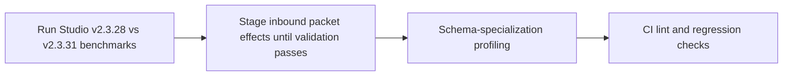

# NetStreamV2 — Prioritized Upgrade Options

**Current:** v3.9.0. Scores below are **engineering priority estimates from 1–10**, not speed measurements or feature quality benchmarks. Every major change requires paired Studio tests and compatibility review.

## v3.9.0 — burst-focused iteration

| Workstream | Delivered | Next check |
|---|---|---|
| Batch/dispatch | Direct outbound batch drain; 32-event dispatch time check | Measure FIFO, CPU p95/p99 and pressure under real workloads |
| Packed sender | Single-preflight Bool/U8/U16 packed writer; 1–3 field inline argument assignment | Compare bytes, CPU, burst rate and allocations vs v3.8.0 |
| Benchmark/validation | 30k-event paired Studio stress bench; 8k deterministic queue model cases | Execute Studio tests and multi-client benchmarks, do not infer speedups from source CI |

## Latest CPU / heap / GC optimization cycle (source-level)

| Release | Focus | Verification |
|---|---|---|
| 3.6.0 | Inline in-capacity bit writes and direct 1–3 vararg packing | Source CI checks; Studio CPU benchmark pending |
| 3.7.0 | One-field packed scalar runs without per-value args tables | Source CI and paired Studio regression scripts; live validation pending |
| 3.8.0 | Do not retain high-water packed arrays after split | Source CI and paired Studio regression scripts; GC measurements pending |

## Previous CPU / heap / GC optimization cycle (source-level)

| Release | Focus | Verification |
|---|---|---|
| 3.3.0 | Bulk discarded-schema runs and safe route-level scalar throttling | Source-level; Studio pending |
| 3.4.0 | Single scalar dispatch payload table and fewer rejected dynamic args acquisitions | Source-level; Studio pending |
| 3.5.0 | Cap retained idle pools; avoid clearing discarded oversized batches | Source-level; Studio pending |

## Previous minor-version heap/overhead cycle (source-level)

| Release | Focus | Verification |
|---|---|---|
| 3.0.0 | Skip fully representable fixed-width rejected schema bits with one preflight | Implemented; Studio validation pending |
| 3.1.0 | Remove short-string per-character decode tables | Implemented; Studio heap benchmark pending |
| 3.2.0 | Avoid args tables on single numeric schema event/state dispatch | Implemented; Studio performance benchmark pending |

## Previous minor-version heap/overhead cycle (source-level)

| Release | Focus | Verification |
|---|---|---|
| 2.7.0 | Eliminate duplicate route ID arrays, cap atomic stage pooling at eight | Source-level; Studio pending |
| 2.8.0 | Pack scalar values and flag into existing stage slots, five-table staging | Source-level; Studio pending |
| 2.9.0 | Drop rate-limited schema tuples without argument allocations | Source-level; Studio pending |

## Previous minor-version optimization sequence (source-level)

| Release | Scope | Status |
|---|---|---|
| 2.4.0 | Atomic BitFrame decode before delivering gameplay effects | Committed; Studio verification pending |
| 2.5.0 | Bound staged allocations and fast-path 1-byte varuint decoding | Committed; Studio heap benchmarks pending |
| 2.6.0 | Elide tiny-scalar argument tables and specialize 1-byte encoding | Committed; Studio benchmarks pending |

## Previous correctness and binary suboptimization cycle (source-level)

| Release | Change | Status |
|---|---|---|
| 2.3.35 | Check state rate limits before applying BitFrame updates | Committed; Studio regression pending |
| 2.3.36 | Bound packed schema run sizes and split oversized packets | Committed; Studio regression pending |
| 2.3.37 | Optimize 64-bit binary access and hybrid string allocations | Committed; Studio benchmarks pending |

## Previous memory/binary optimization cycle (source-level)

| Release | Change | Status |
|---|---|---|
| 2.3.32 | Size packed-run tables to actual fields and bound retained arrays | Committed; Studio memory tests pending |
| 2.3.33 | Start BitFrame writers at 128 B and cap retained writers at 4 KiB | Committed; Studio CPU+memory tests pending |
| 2.3.34 | Buffer-based unaligned string decode and optional idle pool trim | Committed; Studio tests pending |

## Previous completed three-patch cycle (source-level)

| Release | Change | Status |
|---|---|---|
| 2.3.29 | Avoid duplicate BitFrame varuint validation | Committed; Studio benchmarking pending |
| 2.3.30 | Optimize U8 BitFrame runs with one bounds check | Committed; Studio benchmarking pending |
| 2.3.31 | Reject nonfinite legacy composite fixed-schema floats | Committed; Studio regression pending |

## Earlier three-patch cycle

| Chosen option | Release | Priority | Status |
|---|---|---:|---|
| Recover sessions after lost WELCOME / READY | 2.3.23 | 9.4 | Implemented in source |
| Specialize hot U8 schema paths | 2.3.24 | 9.1 | Implemented in source |
| Avoid temporary compression candidate allocations | 2.3.25 | 8.8 | Implemented in source |

The releases above retain BitFrame v1 and the Compression v2.3.5 codec. Dedicated Studio test pairs are authored, but runtime speedups and multiplayer correctness still require Play testing.

## Strongest next options

| Rank | Improvement | Priority /10 | Expected benefit | Important trade-off |
|---:|---|---:|---|---|
| 1 | **Runtime profiling and atomic decode optimization** | **9.8** | Validate new staging semantics and reduce its additional per-packet overhead | Requires paired Studio benchmarks |
| 2 | **Compiled/generated fixed-schema encoders and decoders** | **9.7** | Reduce per-field runtime kind dispatch | Generator maintenance, type-checking and compatibility |
| 3 | **CI-based Luau lint/typecheck + Studio regression harness** | **9.6** | Catch faulty releases before main | Roblox Studio tests may need a dedicated runner |
| 4 | **Field-level delta state replication** | 9.5 | Reduce bytes for slowly changing entity fields | Needs baselines, resync/reliability design |
| 5 | **Per-player interest management (server culling)** | 9.4 | Avoid sending invisible/unrelated entities | Privacy/visibility rules and spatial indexing |
| 6 | **Efficient stable per-entity state snapshots** | 9.3 | Consistent join/reconnect state | Memory, ordering, snapshot versions |
| 7 | **Adaptive per-route loss/latency control** | 9.1 | More resilient high-frequency traffic | Requires accurate runtime metrics |
| 8 | **Bounded decode arena / table cleanup on errors** | 9.0 | Reduce memory retention on malformed data | Lifecycle complexity |
| 9 | **Route-level sampling and p95/p99 dashboards** | 8.9 | Find actual problematic routes | Additional collection overhead |
| 10 | **Reliable-unreliable fallback policy per route** | 8.8 | Avoid unexpected reliable traffic | Some updates must be dropped |
| 11 | **True optional delta/RLE dictionary codecs** | 8.6 | Improve large repetitive payload compression | New wire versions and compatibility tests |
| 12 | **Chunked oversized RPC / state transfers** | 8.4 | Handle large, bounded payloads more predictably | Reassembly, flow control, timeouts |
| 13 | **Build-time route ID/schema manifest checking** | 8.3 | Catch mismatch before runtime | Requires a simple compile/build process |
| 14 | **Automatic cost-based batch-size prediction** | 8.1 | Fewer split/re-encode cycles | Feedback can become unstable |
| 15 | **Docs site, API search, recipes and examples** | 7.9 | Better adoption and onboarding | No direct packet-speed improvement |

## Next work after measuring v2.3.31

**Default recommendation:** prioritize **#1, #2, #3 in that order**. Atomic packet validation closes a meaningful correctness gap in the existing BitFrame receiver. Generated fixed-schema code is the highest prospective CPU optimization, and automated checks reduce regressions across repeated releases.

**Alternative throughput-focused sequence:** #2 → #14 → #9. Best only after Studio numbers reveal the cost center.

**Alternative replication-focused sequence:** #4 → #5 → #6. This is a larger protocol/feature project and should not be treated as a three-small-patch change.

## Release criteria

- Keep the current wire format when the change is source-only; increment the wire/codec version for incompatible layouts.
- Keep schema IDs consistent between server and client.
- Retain reliability, session-replay and rate-limiter protections.
- Add tests for error paths, high-bit values, empty payloads, retry recovery, queue pressure and large batches.
- Compare same-workload v2.3.28/v2.3.31 results before claiming CPU or memory improvements.
- Require a clean source build and Studio multi-client regression run before a production deployment recommendation.

[Current README](../README.md) · [Architecture](ARCHITECTURE.md) · [Benchmark guide](BENCHMARKING.md).
## After v3.8.0

Prioritize measured per-schema CPU costs, Studio heap-after-burst profiles, and GC pause p95/p99 before adding specialized optimizations. Confirm that lower idle-pool caps do not increase GC spikes during sustained message bursts. Do not claim a competitor speed win without the same-workload test.
